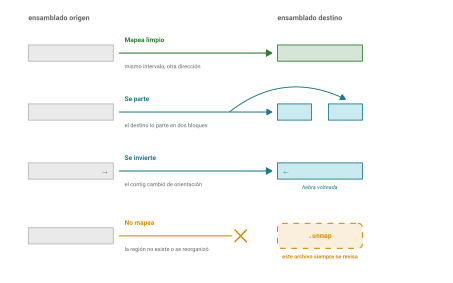
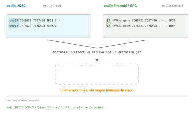

```{=html}
<!-- Capítulo de referencia de la unidad 4. Reúne, como secciones, los
cinco capítulos de la antigua unidad 5 (ensamblados y coordenadas, UCSC,
Ensembl, formatos de anotación, IGV). La práctica de la sesión 10 recorre
lo esencial de este capítulo y del de bases de datos. -->
```

## Idea central

**Una coordenada genómica no significa nada sin su ensamblado. Un browser es un sistema de coordenadas con datos apilados. Mucho de la genómica puede generalizarse como una aritmética de intervalos.**

El genoma como sistema de coordenadas: ensambles, tracks, y los formatos de anotación donde vive todo lo demás. Los ensambles humanos y su conversión; UCSC, que es para mirar; Ensembl, que es para traer; los formatos de anotación operados con `bedtools`, `tabix` y `awk`; e IGV, para cuando los datos son suyos.

## 1. Ensamblados y coordenadas (hg19, hg38, T2T) {#sec-ensamblados}

Una coordenada genómica `chr17:7,668,421` es una dirección válida si está asociada a un ensamble.

### Tres referencias humanas

En 2026 hay tres ensamblados humanos en uso simultáneo.

**GRCh37**, que UCSC llama **hg19**, es de 2009.

**GRCh38**, o **hg38**, es de 2013 con parches posteriores. Es el default de trabajo para casi todo el mundo? Creo que ustedes saben mejor que yo.

**T2T-CHM13**, versión 2.0 de 2022, que UCSC llama **hs1**, es el primero completo sin huecos. Rellena más de 200 megabases que faltaban en GRCh38, alrededor del 8% del genoma: centrómeros, los brazos cortos de los cromosomas acrocéntricos y casi todo el cromosoma Y.

Un estudio de 2025 sobre mil genomas suecos encontró **10 millones de variantes adicionales** al mapear contra CHM13 en lugar de GRCh38, de las cuales 5.5 millones eran singletons, y un 13% más de variantes clasificadas como de impacto moderado o alto. Varios trabajos recientes recomiendan explícitamente adoptarlo, sobre todo para evaluar variantes clínicamente relevantes.

hg19 tiene diecisiete años y sigue vivo en genómica clínica. La razón es que hay pipelines validados, bases de datos de variantes, y sobre todo **reportes clínicos ya emitidos** cuyas coordenadas son de hg19.

::: callout-box
El software instalado tiene una inercia propia.
:::

### El mismo gen, tres direcciones

TP53 es un gen humano, pero cuál es su dirección? (@fig-tres-ensamblados):

| Ensamblado    | Coordenadas de TP53                    |
|---------------|----------------------------------------|
| GRCh37 / hg19 | `NC_000017.10 : 7,571,739 - 7,590,808` |
| GRCh38 / hg38 | `NC_000017.11 : 7,668,421 - 7,687,490` |
| T2T-CHM13v2.0 | `NC_060941.1 : 7,572,544 - 7,591,594`  |

{#fig-tres-ensamblados}

Casi cien mil bases de diferencia entre hg19 y hg38 para el mismo gen. Fíjense que la versión del cromosoma también cambia: `NC_000017.10` contra `NC_000017.11`.

### Convertir coordenadas

Para pasar coordenadas de un ensamblado a otro se usa un **archivo de cadenas** (chain file) que describe el alineamiento entre los dos. Las herramientas son **liftOver**, de UCSC, y **CrossMap**.

``` bash
liftOver entrada.bed hg38ToHg19.over.chain.gz salida.bed sin_mapear.bed
```

**El cuarto argumento tiene un archivo de lo que no se mapeó.**

What is lost in translation (@fig-liftover):

Un intervalo puede **no mapear** porque la región no existe o se reorganizó en el destino. Puede **partirse** en varios pedazos. Puede **mapear a varios lugares** si la región se duplicó. Y una bien traicionera: puede **invertirse**, porque el contig subyacente cambió de orientación entre ensamblados, de modo que la secuencia que era hebra positiva ahora es su complemento reverso.

{#fig-liftover}

Con archivos VCF es peor, porque además hay que reconciliar los alelos de referencia y alternativo. En un mismo conjunto del proyecto 1000 Genomes, CrossMap descartó unas 46,600 variantes donde `bcftools liftover` descartó unas 12,600. Distintas herramientas, distintas pérdidas.

**liftOver es con pérdida**. Más que traducción puede verse como aproximación. Hay que preguntarse si no es mejor hacer el análisis contra el ensamblado nuevo en lugar de convertir resultados viejos.

### chr17 contra 17

Un error u obstáculo común

UCSC nombra los cromosomas `chr1`, `chr2`, ..., `chrM`. El GRC y Ensembl los nombran `1`, `2`, ..., `MT`.

Si intersectan un BED con `chr17` contra un GTF con `17`, obtienen **cero resultados y ningún mensaje de error** (@fig-nomenclatura).

{#fig-nomenclatura}

La solución es normalizar antes de operar:

``` bash
# quitar el prefijo chr
awk 'BEGIN{OFS="\t"}{sub(/^chr/,"",$1); print}' archivo.bed > normalizado.bed

# o ponerlo
awk 'BEGIN{OFS="\t"}{if($1!~/^chr/) $1="chr"$1; print}' archivo.bed
```

### Cómo saber en qué ensamblado está un archivo

Un BED o un GTF no traen encabezado que lo diga. Hay que inferirlo.

El estilo de nombres de cromosoma les dice de qué familia viene (`chr17` sugiere UCSC, `17` sugiere Ensembl o NCBI), pero no la versión. Un VCF sí suele traer líneas `##contig` con longitudes, y comparar esas longitudes contra un `.fai` conocido identifica el ensamblado sin ambigüedad. Un `.fai` propio les da lo mismo directamente.

Y si nada de eso está, queda la peor opción: adivinar por el rango de las coordenadas y rezar.

Una buena posibilidad es **poner el ensamblado en el nombre del archivo y en la bitácora**. `variantes_hg38.vcf`, no `variantes.vcf`.

## 2. UCSC Genome Browser {#sec-ucsc}

Un genome browser es un sistema de coordenadas con cosas apiladas encima. Cada capa se llama **track** (@fig-tracks).

{#fig-tracks}

Un track puede ser la secuencia misma, los genes con su estructura de exones e intrones, una señal continua como cobertura de secuenciación, un conjunto de variantes, la conservación entre especies, marcas de cromatina. Cualquier cosa que se pueda anclar a coordenadas.

"Ver es creer". "Una imagen vale más de mil palabras" y todo eso. Pero no menosprecien el poder de simplemente mirar sus datos para darse una idea, encontrar problemas obvios, o formarse una hipótesis para un análisis futuro.

### Table Browser

La herramienta que distingue a UCSC de los demás es el **Table Browser**, en `genome.ucsc.edu/cgi-bin/hgTables`.

Lo que hace es dar acceso a los datos que están detrás de lo que ve, sin escribir código. Eligen ensamblado, track, región y formato, y les devuelve una tabla o un BED.

Es la puerta de entrada para quien todavía no programa, y sigue siendo cómoda para quien sí.

### Poner sus propios datos

Dos maneras de que UCSC dibuje algo suyo.

Un **custom track** es un archivo que ustedes suben o al que apuntan por URL. Sirve para una sesión de trabajo.

Un **track hub** es una colección de tracks alojada en un servidor, que UCSC lee bajo demanda. Es lo que usan los consorcios para publicar datos, y es también la forma en que UCSC sirve T2T-CHM13, con el nombre `hs1`.

Lo interesante del mecanismo es que **solo se transmite lo que se está viendo**. Si hacen zoom a veinte kilobases, el navegador pide veinte kilobases, no el archivo de treinta gigas. Eso se logra con formatos binarios indexados.

### Los tres formatos binarios

**.2bit** guarda un genoma completo a dos bits por base. **bigWig** guarda señal continua, tipo cobertura. **bigBed** guarda intervalos.

Los tres están indexados por dentro, así que un programa puede pedir por HTTP solo el pedazo que necesita. Es la misma idea del índice `.fai` de samtools que vieron en la sesión 5, aplicada a datos remotos.

Las utilidades de conversión vienen sueltas y se descargan de `hgdownload.soe.ucsc.edu/admin/exe/`: `faToTwoBit`, `bedToBigBed`, `bigWigToBedGraph`, y el `liftOver` de la sección anterior.

### Acceso programático

UCSC tiene una API REST en `https://api.genome.ucsc.edu`.

``` bash
# Listar los ensamblados disponibles
curl -s "https://api.genome.ucsc.edu/list/ucscGenomes" | head -40

# Sacar una secuencia por coordenadas
curl -s "https://api.genome.ucsc.edu/getData/sequence?genome=hg38;chrom=chr17;start=7668420;end=7687490"
```

Fíjense en el `start=7668420` cuando el gen empieza en 7,668,421. La API usa coordenadas 0-based. Otra vez la misma trampa, otra vez sin aviso.

### En qué es bueno

UCSC es el mejor lugar para **mirar**. Si la pregunta es "cómo se ve esta región, qué hay alrededor, se solapa con algo", UCSC gana.

Si la pregunta es "dame los identificadores y las coordenadas de doce mil genes en un archivo", la siguiente sección tiene mejor herramienta.

## 3. Ensembl y BioMart {#sec-ensembl}

Ensembl y UCSC muestran los mismos genomas y se complementan.

**Ensembl es bueno para traer.**

### El modelo de datos

Ensembl piensa en objetos con identificadores estables, y esa estructura es lo que lo hace bueno para consultas programáticas.

Un **gen** es `ENSG`, un **transcrito** es `ENST`, una **proteína** es `ENSP`, un **exón** es `ENSE`. Con código de especie en medio para los no humanos: el gen de ratón es `ENSMUSG`. Igual que en RefSeq, cada uno tiene su versión.

Los **biotypes** (`protein_coding`, `lncRNA`, `processed_pseudogene`) son vocabulario de Ensembl, un filtro más útil para hacer preguntas sobre la anotación de un genoma.

**Ensembl Compara** es la parte de ortología y paralogía. Lo que el capítulo de homología llama reciprocal best hits. Ahí está precalculado para cientos de especies, con métodos basados en árboles en lugar de la heurística del mejor hit.

### BioMart

**BioMart** es su herramienta para acceso programático a conjuntos de datos.

Como habrán visto quizás para SQL, hay que elegir un **dataset** (una especie), unos **filtros** (qué subconjunto quieren) y unos **atributos** (qué columnas quieren de vuelta). Devuelve una tabla.

Es la respuesta a las preguntas que en UCSC son más difíciles traduzcan estos cinco mil identificadores de Ensembl a símbolos HGNC, o denme la posición y el biotype de todos los genes del cromosoma 17.

### La API REST

En `https://rest.ensembl.org`, con una versión aparte para hg19 en `https://grch37.rest.ensembl.org`.

``` bash
# Ficha de un gen por identificador
curl -s 'https://rest.ensembl.org/lookup/id/ENSG00000141510?expand=1' \
  -H 'Content-type:application/json'

# Qué hay solapando una región
curl -s 'https://rest.ensembl.org/overlap/region/human/17:7668421-7687490?feature=gene' \
  -H 'Content-type:application/json'
```

Para preguntas de solapamiento, prefieran el endpoint `overlap` sobre BioMart. BioMart les va a devolver todos los genes con todos sus exones y tienen que filtrar después.

### El puente a R

Puede servirles para su proyecto y ponerlo en práctica en las sesiones con Haydée.

El paquete **biomaRt** de Bioconductor pone BioMart dentro de R:

``` r
library(biomaRt)
mart <- useEnsembl(biomart = "genes", dataset = "hsapiens_gene_ensembl")

getBM(attributes = c("ensembl_gene_id", "hgnc_symbol",
                     "chromosome_name", "start_position", "end_position"),
      filters = "hgnc_symbol",
      values = "TP53",
      mart = mart)
```

Después del examen, las sesiones que quedan del curso son de R. Esto es lo último que ven conmigo y lo primero que van a reconocer allá.

::: callout-box
**Dos avisos prácticos.**

El primero es de cortesía: `biomaRt` pega contra los mismos servidores que la web. Si van a pedir miles de regiones, párenlo en trozos. Treinta personas mandando consultas gigantes al mismo tiempo es la versión Ensembl del problema del límite del NCBI.

El segundo es de caducidad. El release 116, de junio de 2026, es el **último sobre la plataforma actual** de Ensembl. A partir del verano de 2026 `ensembl.org` redirige a la plataforma nueva y los releases previos quedan en Ensembl Archives.

O sea que las capturas de pantalla y algunas URLs de esta sección van a envejecer mal, posiblemente durante el semestre. Si algo no está donde digo, búsquenlo en el archivo y avísenme.
:::

### Cuál usar

{#fig-ucsc-ensembl}

No es una rivalidad. Es que resuelven preguntas distintas, y saber cuál abrir según la pregunta es parte del oficio (@fig-ucsc-ensembl).

## 4. Formatos de anotación en la práctica {#sec-formatos}

Es difícil y poco general entrar los nuts and bolts de los formatos de anotación. Algunas generalidades.

### El único verbo que importa

Tienen unos exones y unas variantes, y quieren saber cuáles variantes caen dentro de cuáles exones. Tienen unos picos de ChIP-seq y unos promotores, y quieren saber cuáles coinciden. Tienen unas regiones conservadas y unos genes, y quieren la intersección.

Todas son la misma operación sobre intervalos, y hay una herramienta que la hace: **bedtools**.

``` bash
# Qué de A se solapa con B
bedtools intersect -a genes.bed -b variantes.bed -wa -wb

# Fundir intervalos que se traslapan entre sí
bedtools merge -i ordenado.bed

# Quitarle a A lo que se solape con B
bedtools subtract -a a.bed -b b.bed

# Para cada intervalo de A, el más cercano de B
bedtools closest -a consulta.bed -b elementos.bed

# Sacar la secuencia de unos intervalos
bedtools getfasta -fi genoma.fa -bed regiones.bed -fo salida.fa
```

`intersect` con `-wa -wb` imprime las dos líneas que se solaparon, la de A y la de B, para que sepan qué pegó con qué. Sin esas banderas solo obtienen la intersección geométrica y pierden la identidad.

`merge` exige que la entrada esté **ordenada**, y esa es la primera fuente de resultados raros:

``` bash
sort -k1,1 -k2,2n entrada.bed > ordenado.bed
```

### La trampa, ahora en serio

Ya saben que BED es 0-based semiabierto y que GTF y VCF son 1-based cerrados. Lo vieron con figura y ejercicio (@fig-coordenadas).

{#fig-coordenadas}

Lo que no han hecho es equivocarse con datos reales, así que va el caso.

Quieren los exones de un GTF como archivo BED. La conversión ingenua:

``` bash
awk -F'\t' '$3=="exon"{print $1"\t"$4"\t"$5}' anotacion.gtf > mal.bed
```

Eso está mal, y no lo van a notar. Cada intervalo queda **corrido una base a la derecha**, porque copiaron un inicio 1-based a un campo que se lee como 0-based. La conversión correcta resta uno al inicio y deja el final igual:

``` bash
awk -F'\t' 'BEGIN{OFS="\t"} $3=="exon"{print $1, $4-1, $5}' anotacion.gtf > bien.bed
```

Un `-1`. Eso separa un conteo correcto de uno equivocado en todos los exones del genoma, sin un solo mensaje de error.

::: callout-box
Los dos errores silenciosos de este capítulo son el mismo tipo de bicho: **producen resultados plausibles**.

La nomenclatura de cromosomas da cero intersecciones. La conversión de coordenadas da intersecciones corridas una base. Ninguno de los dos levanta una excepción, y los dos pasan revisión por pares con frecuencia.

El hábito defensivo es sencillo: cuando un cruce dé cero, sospechen de `chr`. Cuando dé un número que no cuadra por poquito, sospechen del off-by-one. Y siempre, siempre, miren las primeras líneas del archivo antes de operar con él.
:::

### Comprimir e indexar

Un GTF humano completo pesa cientos de megabytes y casi siempre solo necesitan un pedazo. Para eso está indexar.

``` bash
sort -k1,1 -k4,4n anotacion.gtf > ordenado.gtf
bgzip ordenado.gtf
tabix -p gff ordenado.gtf.gz

# Ahora una consulta por región es instantánea
tabix ordenado.gtf.gz 17:7668421-7687490
```

Lo mismo funciona con VCF y con BED, cambiando `-p vcf` o `-p bed`.

Y acá está el detalle que ya vieron con `samtools faidx` en la sesión 5: **`tabix` necesita `bgzip`, no `gzip`**. `bgzip` escribe en bloques independientes que permiten saltar; `gzip` obliga a descomprimir desde el principio. Un archivo comprimido con `gzip` normal no se puede indexar, y ese es un error que van a ver.

### Leer un GTF con awk

El GTF tiene nueve columnas separadas por tabuladores. Las que usan a diario: la 1 es el cromosoma, la 3 el tipo de feature, la 4 y la 5 son inicio y fin, la 7 la hebra, la 9 los atributos.

``` bash
# Cuántos exones hay en el cromosoma 17
awk -F'\t' '$1=="17" && $3=="exon"' anotacion.gtf | wc -l

# Qué tipos de feature existen
cut -f3 anotacion.gtf | sort | uniq -c | sort -rn

# Las líneas de un gen por nombre
awk -F'\t' '$9 ~ /gene_name "TP53"/' anotacion.gtf
```

Ese último usa un match de expresión regular sobre la columna 9, que es texto libre con pares clave-valor. Es funcional y es frágil: `TP53` también hace match con `TP53TG1`. Para trabajo serio conviene delimitar mejor o usar una biblioteca.

### Leer un VCF

Un VCF tiene tres partes. Las líneas que empiezan con `##` son metadatos: versión del formato, las líneas `##contig` con los cromosomas y sus longitudes (que es donde se puede identificar el ensamblado), y las definiciones de los campos INFO y FORMAT.

La línea que empieza con un solo `#` son los encabezados de columna: `CHROM POS ID REF ALT QUAL FILTER INFO` y, si hay muestras, `FORMAT` más una columna por muestra.

Y de ahí para abajo, una variante por renglón.

``` bash
# Ver solo la cabecera
bcftools view -h variantes.vcf.gz | tail -20

# Las primeras variantes, en columnas legibles
bcftools query -f '%CHROM\t%POS\t%REF\t%ALT\n' variantes.vcf.gz | head
```

Con leer `CHROM`, `POS`, `REF` y `ALT` tienen lo suficiente para saber qué cambió y dónde. El resto lo van a necesitar cuando lleguen a llamado de variantes, que no es este curso.

::: callout-box
**Para ir más a fondo, dos libros.**

Vince Buffalo, *Bioinformatics Data Skills* (O'Reilly, 2015). El capítulo 9, *Working with Range Data*, es esta sección entera contada despacio: coordenadas 0-based y 1-based, `bedtools` y GenomicRanges sobre los mismos datos. El 11 es de alineamientos, con `samtools` e IGV, y el 13 explica por qué `tabix` funciona. Los datos de todos los ejemplos están en [github.com/vsbuffalo/bds-files](https://github.com/vsbuffalo/bds-files).

Altuna Akalin, *Computational Genomics with R* (CRC Press, 2020), gratis en línea en [compgenomr.github.io/book](https://compgenomr.github.io/book/). El [capítulo 6](https://compgenomr.github.io/book/genomicIntervals.html), *Operations on Genomic Intervals and Genome Arithmetic*, es la misma aritmética de intervalos hecha en R con GenomicRanges: solapar, contar, dibujar un locus. Es el puente natural a la unidad 5. Y la [sección 1.5](https://compgenomr.github.io/book/visualization-and-data-repositories-for-genomics.html) resume en dos páginas los browsers (UCSC, Ensembl, IGV) y los repositorios de datos.
:::

## 5. IGV {#sec-igv}

UCSC y Ensembl viven en un servidor y les muestran datos públicos. **IGV vive en su computadora y les muestra sus archivos.**

Esa es toda la diferencia, y es la que importa el día que tengan datos propios.

### Qué es

El **Integrative Genomics Viewer** es una aplicación de escritorio que carga un genoma de referencia y le apila encima los archivos que ustedes le den: anotación, variantes, alineamientos, señal.

Su uso canónico es mirar alineamientos de lecturas contra la referencia, que es como se detectan a ojo los artefactos que ningún filtro automático atrapa. Eso lo van a hacer en cuarto semestre, cuando vean mapeo de lecturas.

Hoy lo vemos por otra razón: porque es donde se cobra todo lo de la sección anterior.

### El índice no es opcional

IGV no carga un archivo grande sin su índice. Y esa exigencia es pedagógicamente perfecta, porque el índice es exactamente lo que acabamos de construir.

Una referencia FASTA necesita su `.fai`, que hacen con `samtools faidx`. Un VCF comprimido necesita su `.tbi`, que hacen con `tabix`. Un BAM necesita su `.bai`. Un GFF grande, su `.tbi`.

Si IGV se niega a cargar algo, la primera hipótesis es que falta el índice o que el archivo se comprimió con `gzip` en lugar de `bgzip`.

### Qué van a cargar hoy

Como todavía no tienen alineamientos propios, vamos a montar la vista con lo que sí tienen:

- El **cromosoma 17** como referencia, con su `.fai`.
- El **GTF** de anotación, para ver la estructura de exones de TP53.
- Un **VCF de ClinVar** recortado a la región, para ver variantes reportadas encima de esos exones.

Con eso ya se ve la idea completa: coordenadas abajo, anotación en medio, datos encima.

### Las versiones

**IGV de escritorio** es la aplicación completa, en Java, y es la que usan casi todos.

**IGV-web** corre en el navegador, sin instalar nada, y sirve para una mirada rápida o para una clase.

**igv.js** es la biblioteca de JavaScript con la que se embeben vistas de IGV en una página web. Si alguna vez han visto un browser incrustado en el sitio de un consorcio, probablemente era igv.js.

Para hoy usamos IGV-web, porque instalar treinta copias de una aplicación de escritorio en clase no es un buen uso de dos horas.

## Fuentes {.unnumbered}

**Libros**

- Buffalo, V. (2015). *Bioinformatics Data Skills*. O'Reilly. Capítulos 9 (rangos y coordenadas, `bedtools`, GenomicRanges), 11 (alineamientos, `samtools`, IGV) y 13 (`tabix`). <https://vincebuffalo.com/book/> · datos de los ejemplos: <https://github.com/vsbuffalo/bds-files>
- Akalin, A. (2020). *Computational Genomics with R*. CRC Press. Gratis en línea: <https://compgenomr.github.io/book/>. Capítulo 6, *Operations on Genomic Intervals and Genome Arithmetic*; sección 1.5, *Visualization and data repositories for genomics*.

**Ensamblados y coordenadas**

- Nurk, S. et al. (2022). The complete sequence of a human genome. *Science* 376(6588): 44-53. [doi:10.1126/science.abj6987](https://doi.org/10.1126/science.abj6987)
- Schmitz, D., Ameur, A. & Johansson, Å. (2025). T2T-CHM13 improves read mapping and detection of clinically relevant variation. *Genome Research* 35(11): 2377-2388. [doi:10.1101/gr.279320.124](https://doi.org/10.1101/gr.279320.124)
- Zhao, H. et al. (2014). CrossMap: a versatile tool for coordinate conversion between genome assemblies. *Bioinformatics* 30(7): 1006-1007. [doi:10.1093/bioinformatics/btt730](https://doi.org/10.1093/bioinformatics/btt730)
- BCFtools/liftover (2024). *Bioinformatics* 40(2): btae038. [doi:10.1093/bioinformatics/btae038](https://doi.org/10.1093/bioinformatics/btae038)
- UCSC. liftOver y archivos de cadenas. <https://genome.ucsc.edu/cgi-bin/hgLiftOver>
- Genome Reference Consortium. <https://www.ncbi.nlm.nih.gov/grc>

**UCSC**

- UCSC Genome Browser. <https://genome.ucsc.edu>
- Nassar, L. R. et al. (2026). The UCSC Genome Browser database: 2026 update. *Nucleic Acids Research*. [doi:10.1093/nar/gkaf1250](https://doi.org/10.1093/nar/gkaf1250)
- Documentación de la API REST. <https://genome.ucsc.edu/goldenPath/help/api.html>
- Track hubs y custom tracks. <https://genome.ucsc.edu/goldenPath/help/hgTrackHubHelp.html>
- Utilidades de línea de comandos. <https://hgdownload.soe.ucsc.edu/admin/exe/>

**Ensembl**

- Ensembl. <https://www.ensembl.org>
- Ensembl 2026. *Nucleic Acids Research*, Database issue.
- Documentación de la API REST. <https://rest.ensembl.org>
- Durinck, S. et al. (2009). Mapping identifiers for the integration of genomic datasets with biomaRt. *Nature Protocols* 4: 1184-1191. [doi:10.1038/nprot.2009.97](https://doi.org/10.1038/nprot.2009.97)
- Ensembl Archives, para releases anteriores. <https://www.ensembl.org/info/website/archives/>

**Formatos de anotación**

- Quinlan, A. R. & Hall, I. M. (2010). BEDTools: a flexible suite of utilities for comparing genomic features. *Bioinformatics* 26(6): 841-842. [doi:10.1093/bioinformatics/btq033](https://doi.org/10.1093/bioinformatics/btq033)
- Documentación de bedtools. <https://bedtools.readthedocs.io/>
- Li, H. (2011). Tabix: fast retrieval of sequence features from generic TAB-delimited files. *Bioinformatics* 27(5): 718-719. [doi:10.1093/bioinformatics/btq671](https://doi.org/10.1093/bioinformatics/btq671)
- Danecek, P. et al. (2011). The variant call format and VCFtools. *Bioinformatics* 27(15): 2156-2158. [doi:10.1093/bioinformatics/btr330](https://doi.org/10.1093/bioinformatics/btr330)
- Especificaciones de VCF y de los índices. <https://samtools.github.io/hts-specs/>
- Especificación de GFF3, Sequence Ontology. <https://github.com/The-Sequence-Ontology/Specifications/blob/master/gff3.md>

**IGV**

- Robinson, J. T. et al. (2011). Integrative Genomics Viewer. *Nature Biotechnology* 29(1): 24-26. [doi:10.1038/nbt.1754](https://doi.org/10.1038/nbt.1754)
- IGV, documentación y descargas. <https://igv.org/>
- IGV-web. <https://igv.org/app/>
- igv.js. <https://github.com/igvteam/igv.js>
