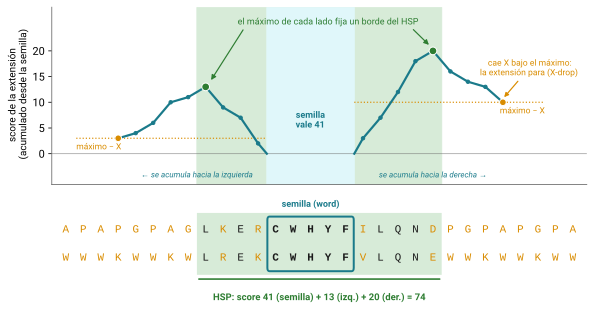
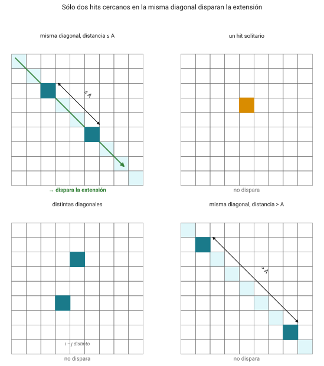
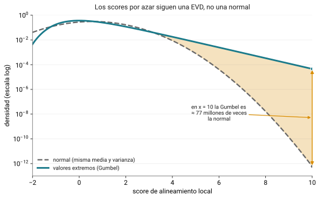
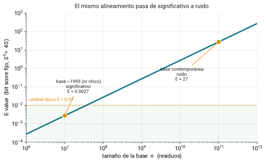
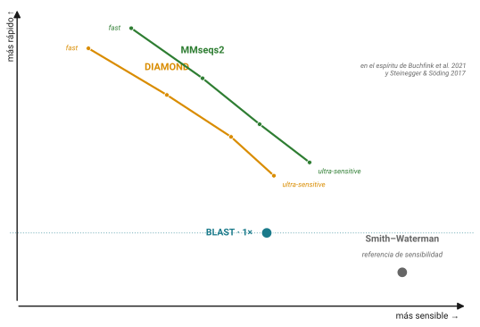

# Búsqueda heurística {.section-divider}

## Sensibilidad vs velocidad

::: callout-box
Query de 300 residuos contra 200 millones de secuencias por
Smith–Waterman: \~1.8 × 10¹³ operaciones. **Horas.**
:::

- Aunque Smith-Waterman garantiza encontrar el mejor alineamiento, es
  tardado.
- La respuesta fue pasar de determinista a estadístico
- De "¿cuál es el mejor alineamiento?" a **"¿me sorprendería este
  parecido por azar?"**

## Las tres ideas de hoy

1.  **Seed-and-extend** o cómo funciona blast
2.  **El E-value** es el valor esperado de high-scoring pairs
3.  Parámetros que cambian el resultado

::: callout-box
BLAST no calcula Smith–Waterman ni lo aproxima como algoritmo. Es un
algoritmo distinto con objetivo propio, estadística propia y su propia
métrica también, el E-value.
:::

## El plan del día

| Horario | Bloque |
|----|----|
| 10:00–11:45 | Teoría: seed-and-extend, E-value, sabores, BLAT, BWA, estructura |
| 11:45–12:15 | Descanso |
| 12:15–14:30 | Práctica: BLAST+ local sobre la vía WNT de la babosa |
| 14:30–15:00 | Cierre, dudas, entregable |

# Una contra muchas {.section-divider}

## Alinear dos secuencias está básicamente resuelto

- El problema es alinear **una contra todas las demás**
- Smith–Waterman exacto sigue siendo la referencia de sensibilidad, pero
  contra la base entera es inpráctico
- Hace falta tomar un atajo.

## FASTP y FASTA (1985, 1988) {.smaller}

- Lipman & Pearson: localizar rápido las regiones prometedoras y sólo
  ahí gastar el alineamiento caro
- FASTA: k-tuples exactos → reescorar diagonales con matriz → unir
  regiones → Smith–Waterman en banda
- Siguen vivos: el servidor FASTA de Virginia y SSEARCH
- BLAST ganó por tres cosas: \~10× más rápido, **E-value calibrado** en
  vez de score crudo, y el servidor del NCBI
- Mientras que FASTA parte de identidades exactas; BLAST parte de
  **neighborhood words**

# Seed-and-extend {.section-divider}

## Neighbour words (sólo blastp) {.smaller}

Digamos que k es 3, y que la secuencia que vamos a buscar contiene el
kmer CFC:

- ¿Cuáles son los posibles 3-mers que tengan un score por arriba de
  cierto threshold con cierta matriz de sustitución?

- Pueden ser, CIC, CLC, CMC, CWC y CYC

- Las semillas matches exactos de todos estos (mas CFC) en el genoma

## Sembrar y extender {.smaller}

{fig-align="center"}

- **Sembrar**: palabras de tamaño $W$; en proteínas, todas las vecinas
  que puntúen ≥ $T$ contra la query; en DNA, match exacto
- **Extender**: sin gaps, hacia ambos lados, hasta caer $X$ por debajo
  del máximo (X-drop) → **HSP**

## Las dos parámetros

::: callout-box
Bajar $T$ aumenta la probabilidad de sembrar un HSP verdadero, pero
dispara el número de hits y el tiempo. Subir $W$ acelera pero pierde
homólogos lejanos.
:::

**Cada parámetro de BLAST equilibra ese canje.** En la web, sólo Word
size está expuesto como un parámetro modificable de 2,3,5 y 6. En la
línea de comandos los parámetros son `-word_size` y `-threshold`. Este
último sólo para proteínas.

## Gapped BLAST y PSI-BLAST {.smaller}

{fig-align="center"}

- **Dos hits**: la extensión (lo caro) sólo se dispara con dos word hits
  en la misma diagonal y cercanos → se puede subir $T$ sin perder
  sensibilidad neta
- **Extensión con gaps**: un Smith–Waterman confinado a una franja
- **PSI-BLAST**: en iteraciones, perfiles empíricos sustituyen a la
  matriz Blosum o PAM

# La estadística de la comparación local: el E-value {.section-divider}

## Karlin–Altschul (1990) describen número de HSPs con score al menos S

$$E = K \cdot m \cdot n \cdot e^{-\lambda S}$$

- $E$: número **esperado** de alineamientos con score ≥ $S$ por puro
  azar en el espacio de búsqueda. Va de 0 a infinito
- $m \cdot n$: query × base = el espacio de búsqueda
- $\lambda$, $K$: constantes del sistema de scoring (para BLOSUM62,
  $\lambda \approx 0.27$ y $K \approx 0.04$)

::: notes
Es lo que separa a BLAST de "un programa que encuentra parecidos" y lo
convierte en un instrumento de medición.
:::

## El bit score es log odds en base 2 {.smaller}

$$S' = \frac{\lambda S - \ln K}{\ln 2}, \qquad E = m \cdot n \cdot 2^{-S'}$$

- El raw score depende de la matriz de sustitución, o bien, de k y
  lambda. Este score es como dar una distancia sin decir si son metros,
  centímetros o años luz
- **bit score** absorbe $\lambda$ y $K$. Esa división por $ln2$ le da
  unidades de bits
- Bit score es el $log_2$ de cuán más probable es el alineamiento bajo
  homología que bajo azar
- No depende de la longitud de la secuencia ni la base de datos
- Sólo depende de la longitud del alineamiento.

## El E-value es el valor esperado

$$S' = \frac{\lambda S - \ln K}{\ln 2}, \qquad E = m \cdot n \cdot 2^{-S'}$$

- Éste sí depende de cuántas veces intentamos
- Dado un **bit score**, cuántas veces esperamos un HSP

## Por qué valores extremos y no una normal {.smaller}

{fig-align="center"}

- Igual que la suma de variables estocásticas independientes es normal,
  el máximo de las mismas tiende a una distribución EVD
- Un score local óptimo ya es un **máximo** entre muchísimos
  alineamientos (HSPs)
- Se usa Gumbel que modela la distribución del máximo de un número de
  muestras de varias distribuciones
- Si se usara la distribución normal se subestimaría la probabilidad de
  un score alto por azar

## E depende del tamaño de la base de datos {.smaller}

{fig-align="center"}

- Mismo alineamiento, bit score 40: base de 10⁷ (`nr` de los noventa) →
  E ≈ 0.003; base de 10¹¹ (`nr` hoy) → E ≈ 27
- E-value es un conteo esperado
- **Al citar un E-value, hay que citar también la base de datos**

::: notes
El mismo mensaje del capítulo pasado en otra clave: el resultado depende
de un parámetro que ustedes, o el crecimiento de las bases, eligieron.
Un hit significativo en un paper de 1998 puede no serlo hoy.
:::

# Los sabores de BLAST {.section-divider}

## Comparación entre aminoácidos y/o ácidos nucléicos {.smaller}

| Programa | Query | Base | Traduce | Uso típico |
|----|----|----|----|----|
| `blastn` | nt | nt | no | DNA vs DNA |
| `blastp` | aa | aa | no | proteína vs proteína |
| `blastx` | nt | aa | la query (6 marcos) | anotar ORFs o reads |
| `tblastn` | aa | nt | la base (6 marcos) | genomas sin anotar |
| `tblastx` | nt | nt | ambos (36 marcos) | regiones sin anotar |
| `dc-megablast` | nt | nt | no | codificantes divergentes (semillas que ignoran la tercer posición del codón) |
| `deltablast` | aa | aa | no | perfil inicial desde conserved domain database (CDD) |

## PSI-BLAST y la deriva de perfil {.smaller}

- `blastp` → PSSM con los hits significativos → buscar con el perfil →
  iterar
- Encuentra parecidos débiles que una sola pasada no ve

## DIAMOND y MMseqs2 {.smaller}

{fig-align="center"}

- **DIAMOND** (Buchfink 2015, 2021): doble indexado, spaced seeds,
  alfabeto reducido \[KREDQN\] \[ILV\] \[STA\] los cuenta como el mismo
  aminoácido; sensibilidad de BLASTP con 2–4 órdenes de magnitud menos
  de tiempo
- **MMseqs2** (Steinegger & Söding 2017): prefiltro de k-mers para
  descartar la mayoría de las secuencias antes de alinear; los MSA de
  AlphaFold y ColabFold se generan con MMseqs2

## Heurística de uso {.smaller}

- Consulta puntual, una query contra `nr` en la web: **BLAST** sigue
  siendo el default correcto (interpretabilidad, E-values calibrados,
  ecosistema del NCBI)

- A escala (proteomas, metagenómica, clustering): **DIAMOND** para
  proteínas y traducido, **MMseqs2** (Many against many sequence search)
  para búsqueda y clustering masivos

- BLAST es la referencia de **sensibilidad**, no de **velocidad**

  ::: {}
  > "In an experimental study we estimated that querying the (NCBI)
  > non-redundant (nr) database (\~280 million sequences) against the
  > UniRef50 database (\~40 million sequences) using BLASTP would
  > require more than 2 months even on a supercomputer ... However, the
  > newly developed version of DIAMOND can now accomplish the same task
  > in several hours, with an alignment sensitivity that matches BLAST"
  :::

# BLAT es STALB (blast al revés) {.section-divider}

## Qué se indexa {.smaller}

{fig-align="center"}

> "Where BLAST builds an index of the query sequence and then scans
> linearly through the database, BLAT builds an index of the database
> and then scans linearly through the query sequence."

[Kent 2002, *Genome Research* 12(4):656-664]{.ref}

## Indexar la consulta o indexar la base

::::: columns-equal
::: {}
**Indexar la consulta (BLAST)**

- Contra cualquier base, sin preparar nada
- "¿Qué hay en el mundo que se parezca a esto?"
:::

::: {}
**Indexar la base (BLAT)**

- Se paga una vez el índice; cada consulta es casi instantánea
- **Muchas** preguntas contra **el mismo** genoma o transcriptoma
:::
:::::

::: notes
Honestidad: BLAST también puede indexar la base hoy (makembindex 2008,
megablast indexado en la web). La dicotomía limpia es didáctica; la
consecuencia sigue siendo cierta: BLAT asume alta identidad y BLAST no.
:::

## Nació de un deadline panic {.smaller}

- Kent, UCSC, 2000: colocar 3 millones de ESTs y 13 millones de lecturas
  de ratón sobre el borrador del genoma humano, en ciclos de dos semanas
- Índice de k-mers no traslapados en RAM; k-mers sobreusadas excluidas
- Diseñado para **≥95% de identidad y longitud \> 40**. Fuera de esa
  ventana no encuentra nada
- Es el canje por la velocidad

## Coser exones

- Un cDNA no tiene intrones; el genoma sí → el alineamiento correcto son
  varios bloques separados por huecos enormes
- BLAT agrupa hits por diagonal, alinea por separado y **cose** con
  programación dinámica, ajustando los bordes a sitios de splicing
- Reconstruye la estructura de exones; salida en formato **PSL**
- Es la versión algorítmica del dot plot genómico contra cDNA

## BLAT en 2026 y las semillas espaciadas {.smaller}

- Sigue vivo y mantenido por UCSC en su genome browser
- Nicho: colocar una secuencia sobre un genoma de la misma especie. Yo
  lo uso para in silico PCR con pares de primers.
- Para mapeo masivo perdió contra BWA y Bowtie; para long reads, contra
  minimap2

::: callout-box
**PatternHunter (2002)**: una semilla espaciada como
`111010010100110111` (donde sólo los 1 son matches) pesa lo mismo que
once consecutivas y tiene **más sensibilidad**, porque sus aciertos son
más independientes. Hoy es estándar en LAST, LASTZ y DIAMOND.
:::

# Pilón: mapear millones de lecturas {.section-divider}

## Un tercer problema (que verán en otro semestre) {.smaller}

- BLAST: ¿qué hay en el mundo que se parezca a esto?
- BLAT: ¿dónde está esta secuencia en este genoma?
- **BWA: ¿de dónde vino cada uno de estos cien millones de fragmentos?**

Tres dimensiones distintas: escala de millones de consultas, identidad
altísima, y una posición por lectura.

## Burrows–Wheeler en cuatro ideas {.smaller}

1.  **Permutación reversible** del genoma que agrupa contextos parecidos
    (y por eso comprime)
2.  **Búsqueda hacia atrás**: el patrón carácter por carácter; el
    conjunto de candidatos se estrecha en cada paso
3.  **El tiempo depende del largo de la lectura, no del genoma**
4.  Índice **residente**: \~4 GB para el genoma humano, se construye una
    vez

Si les da curiosidad, es el [capítulo
9](https://cogniterra.org/lesson/62001/step/1?unit=53665) del libro de
Compeau y Pevzner

El mapeo a fondo (bwa index, bwa mem, samtools) es contenido de cuarto
semestre.

## MAPQ contra E-value {.smaller}

{fig-align="center"}

- **E-value**: sorpresa. Crece con el tamaño de la base
- **MAPQ** $= -10 \log_{10} P(\text{posición equivocada})$: unicidad.
  Depende de si hay otro lugar que explique la lectura igual de bien
- Una lectura **100% idéntica** puede tener **MAPQ 0** si cae en una
  repetición
- MAPQ no es comparable entre alineadores

## En resumen {.smaller}

|   | BLAST | BLAT | BWA-MEM |
|----|----|----|----|
| Qué indexa | la consulta (query) | el genoma (subject) | el genoma (índice FM) |
| Qué recorre | la base (subject) | la consulta (query) | las lecturas |
| Consulta típica | una secuencia | mRNAs, primers | millones de lecturas |
| Identidad esperada | hasta \~25% | ≥95% | ≥\~95% |
| Salida | tabular | PSL, exones cosidos | SAM/BAM |
| Métrica | E-value: sorpresa | identidad y bloques | MAPQ: unicidad |
| La pregunta | ¿qué se parece? | ¿dónde está acá? | ¿de dónde vino? |

::: notes
TODO: figuras/svg/blast_tres.svg existe (esquema de las tres preguntas,
sin referenciar en el capítulo). Decidir si va aquí en lugar de la tabla
o en una diapositiva aparte.
:::

# Segundo pilón: Búsqueda por estructura {.section-divider}

## Foldseek: buscar estructura como si fuera secuencia {.smaller}

- La estructura se conserva más que la secuencia; lo nuevo es que hay
  estructura predicha para casi todo
- **Alfabeto 3Di** (van Kempen et al. 2024): 20 estados de interacción
  terciaria de cada residuo i con el vecino espacial más cercano j → una
  estructura se vuelve una cadena y se busca con una matriz tipo BLOSUM
- 4–5 órdenes de magnitud más rápido que Dali y TM-align, conservando
  \~86–88% de su sensibilidad

## La escala nueva y los perfiles que no murieron {.smaller}

- AlphaFold DB: \~300 mil estructuras (2021) → \>214 millones (2024)
- Barrio-Hernandez et al. 2023: 2.3 millones de clusters estructurales,
  \~31% sin anotación → la materia oscura del espacio de proteínas
- Orden creciente en sensibilidad y costo computacional: **secuencia**
  (BLAST, DIAMOND, MMseqs2) → **perfil** (HMMER, HHblits) →
  **embeddings** (pLM-BLAST) → **estructura** (Foldseek)

::: desventaja
**¿Ortología por estructura?** FoldTree y Unicore (2025) a favor; *Mol
Biol Evol* 2025 en contra: los métodos estructurales no superaron al
modelo LG en filogenómica a gran escala.
:::

## El resumen (1 de 2) {.smaller}

1.  **BLAST es distinto a Smith–Waterman**: aproxima el resultado, no
    ejecuta el algoritmo
2.  **El E-value no es un p-value"**: relacionados, pero $E$ puede ser
    mayor que 1
3.  **E-value bajo != homólogo**: improbable por azar, nada más
4.  **La cobertura importa además del % de identidad**
5.  **megablast vs blastn**: diferencia sobre todo en word size (28
    vs 11) sube velocidad a costa de sensibilidad
6.  **BLAST no encuentra todos los homólogos**: es heurístico
7.  **BLAT no es BLAST es BLAST "al revés"**: indexa la base y asume
    ≥95%; busca otra cosa

# La práctica de hoy. Después del break {.section-divider}

## BLAST+ local sobre la vía WNT de la babosa {.smaller}

- La práctica vive en el sitio: [**Práctica: BLAST+
  local**](../contenido/03-alineamientos/sesion08-practica.html)
- Rehacer el **primer paso real** del proyecto R-spondina/LGR: ¿qué
  genes del módulo WNT–RSPO–LGR tiene de verdad el genoma de *Deroceras
  laeve*?
- **Base**: proteoma v1.2 (43,905 proteínas) con `makeblastdb`
- **Consultas**: 72 proteínas de referencia (18 genes × humano y 3
  moluscos) con `blastp -outfmt "6 std qcovs"`
- **Parsear**, el concepto del día: `cut`, `sort` y `awk` sobre la
  tabla; ubicar los hits en el genoma con `mapa_mrna.tsv`
- **Alinear la familia** con MAFFT: el puente a la sesión 9
- Bonus: mejor hit recíproco, anticipo de la sesión 10

**Entregable** · script que reciba un FASTA, corra BLAST contra la base
local y reporte los top-5 hits en tabla

::: notes
Datos, clave de respuestas y SOLUCIONES.md en
planeacion/practica_blast/. Tiempos medidos en Fénix (2026-08-18):
makeblastdb 2 s, blastp 39 s, MAFFT 4 s.
:::

## La trampa de `-max_target_seqs` {.smaller}

::: desventaja
`-max_target_seqs 1` **no** devuelve el mejor hit: devuelve el
**primero** que supera el umbral de E-value (Shah et al. 2019). Parte
fue un bug corregido en BLAST+ 2.8.1 (Madden et al. 2019), pero el
malentendido sobrevive.
:::

Regla para la práctica: pedir más hits de los que necesitan y filtrar
después por `bitscore` con `awk`.

::: callout-box
Capítulo de referencia:
[BLAST](../contenido/03-alineamientos/blast.html)
:::

## Lectura

- Altschul et al. 1990 (*J Mol Biol*) y 1997 (*Nucleic Acids Res*): los
  dos papers de BLAST
- Kerfeld & Scott 2011, *PLoS Biology*: *Using BLAST to Teach
  "E-value-tionary" Concepts* (CC BY)
- Kent 2002, *Genome Research*: BLAT
- Heladia Salgado: [Blast, variables y
  scripts](https://lcg-cursos.github.io/material/introbioinfo/blast_var_for_scripts.html)
