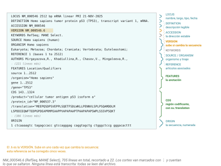
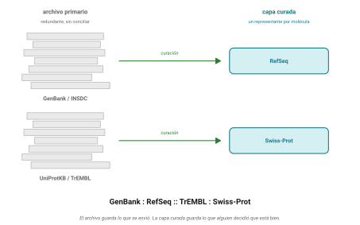
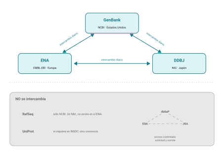
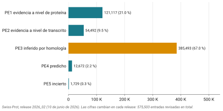
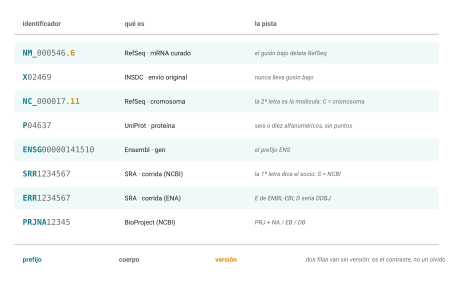
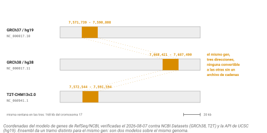
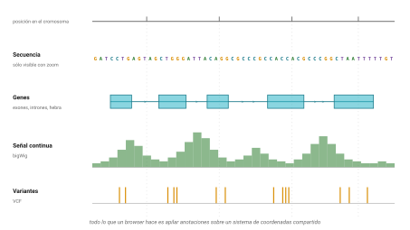
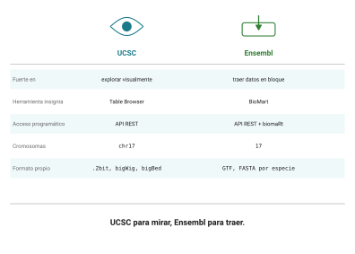
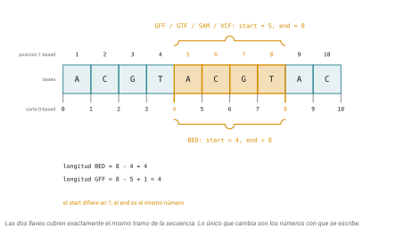

# La tarde {.section-divider}

## Un genoma, siete paradas {.smaller}

- Dos capítulos de referencia en el sitio: [Bases de datos
  biológicas](../contenido/04-bases-datos-browsers/bases-de-datos.html)
  y [Genome
  browsers](../contenido/04-bases-datos-browsers/browsers.html). Hoy no
  los recorremos: los **usamos**
- El hilo es un genoma que conocen: el de *Deroceras laeve*, que este
  laboratorio secuenció, ensambló y depositó
- Qué hay de la babosa en el archivo público y cómo se pide sin dar
  clics; cómo se lee un registro; qué **no** hay y por qué; cómo se
  bajarían las lecturas; y el genoma dibujado, con la anotación y la
  expresión por tejido encima
- Cómputo del día: **`curl` como cliente de bases de datos**. Una URL
  con parámetros es una consulta; lo que regresa es texto para `awk`,
  `cut`, `sort`, `uniq`. Y `md5sum`

::: callout-box
La práctica, con soluciones, vive en el sitio: [Práctica: un genoma,
siete
paradas](../contenido/04-bases-datos-browsers/sesion10-practica.html).
Los datos ya están bajados: en `ken` y en una USB, porque las dos
últimas paradas van en su laptop.
:::

## Qué se corre y qué no {.smaller}

| Parada | Va a | ¿En vivo? |
|------------------------|------------------------|------------------------|
| 1 Pedir sin dar clics | ENA Portal API | sí, es texto chico |
| 2 Un registro, dos formatos | NCBI E-utilities y ENA | NCBI: nop; ENA: todos |
| 3 La proteína que no está | UniProt REST | sí |
| 4 Bajar lecturas | ENA filereport, SRA | la consulta sí; la descarga **no** |
| 5 El genoma en UCSC | el hub de Praga | sí, en el navegador |
| 6 Los archivos | la USB y `ken` | sí |
| 7 IGV | la laptop | sí |

::: desventaja
El NCBI limita a **tres peticiones por segundo por IP**, y `ken` sale
con una sola para los treinta. Pasarse devuelve un 429 para todos. Las
consultas al NCBI las corre una persona.
:::

# Bases de datos {.section-divider}

## El NCBI son unas treinta bases de datos conectadas {.smaller}

- Se fundó en 1988 dentro de la National Library of Medicine; empezó
  administrando sólo GenBank
- **Entrez** es el sistema de búsqueda que integra literatura,
  secuencia, variación, estructura y expresión
- Lo importante son los **enlaces cruzados**: cada registro sabe con qué
  registros de otras bases se relaciona. De la ficha de un gen al mRNA,
  a la proteína, a los artículos, a las variantes. Es un grafo para la
  información biológica
- Las que van a usar: **Nucleotide**, **Protein**, **Gene** (el mejor
  lugar para *empezar*), **Genome** y **Datasets**, **SRA** (lecturas
  crudas), **GEO** (expresión procesada), **PubMed** y **PMC**,
  **Taxonomy** (*Homo sapiens* es 9606; la babosa, 147581), **dbSNP** y
  **ClinVar**

## Las secciones de un registro de GenBank

{fig-align="center"}

::: notes
LOCUS con nombre corto, longitud, tipo de molécula y fecha; DEFINITION;
ACCESSION y VERSION; SOURCE y ORGANISM con su linaje; REFERENCE;
FEATURES, que es la anotación; ORIGIN, la secuencia numerada. La figura
es el mRNA de TP53; en la parada 2 van a leer uno de la babosa.
:::

## Sacar cosas sin dar clics {.smaller}

- Para cinco secuencias la interfaz web está bien. Para quinientas, o
  para que el análisis sea reproducible, hay que pedirlas desde código
- El NCBI expone las **E-utilities**: URLs con parámetros. `esearch`
  busca, `efetch` descarga, `esummary` resume, `elink` salta entre
  bases, `einfo` lista qué hay
- Encima de ellas está **EDirect**, que envuelve esas URLs en comandos
  de UNIX con pipes. En `ken` no está instalado, y no hace falta: **cada
  comando de EDirect es una URL, y `curl` la pide igual**
- Ojo: UID y accession no siempre son lo mismo (`nuccore` acepta
  accession; `gene` quiere GeneID; `snp` quiere el número de rs sin
  prefijo)

::: callout-box
Pasarse de tres peticiones por segundo devuelve un error 429. Con una
llave de API gratuita sube a diez: cuando armen un script propio que
haga muchas llamadas, saquen la suya y métanla en `NCBI_API_KEY`.
:::

## Parada 1 · Pedir sin dar clics {.smaller}

El ENA tiene una API de portal donde una URL es una consulta:

``` bash
curl -s "https://www.ebi.ac.uk/ena/portal/api/search?result=sample&query=scientific_name%3D%22Deroceras%20laeve%22&fields=sample_accession,sample_alias,tissue_type,dev_stage,sex,collection_date,country,study_accession&format=tsv&limit=0" > resultados/muestras.tsv

curl -s "https://www.ebi.ac.uk/ena/portal/api/search?result=read_run&query=scientific_name%3D%22Deroceras%20laeve%22&fields=run_accession,study_accession,sample_accession,library_strategy,library_source,instrument_platform,read_count,fastq_bytes,fastq_md5,fastq_ftp&format=tsv&limit=0" > resultados/corridas.tsv
```

- `result`: qué tipo de registro · `query`: el filtro, con `%3D` por `=`
  y `%22` por comillas · `fields`: qué columnas · `limit=0`: todas
- ¿Cuántas muestras, de qué tejidos, de dónde? ¿Cuántas corridas, de qué
  tipo, de cuántos proyectos? ¿Cuántas lecturas suman?

``` bash
awk -F'\t' 'NR>1{split($7,p,":"); c[p[1]]++} END{for(k in c) print c[k], k}' resultados/muestras.tsv | sort -rn
cut -f4 resultados/corridas.tsv | sort | uniq -c | sort -rn
awk -F'\t' 'NR>1{s+=$7} END{printf "%.0f millones\n", s/1e6}' resultados/corridas.tsv
```

## Parada 1 · lo que deben ver {.smaller}

- **45 muestras**: 24 de Querétaro, 19 de Frankfurt, 2 de Glasgow. Pared
  corporal 15, cola 7, ovotestis 6, cabeza 6, juveniles 6, pie 3, y las
  dos del ensamblado
- **44 corridas**: 38 RNA-seq, 5 WGS, 1 Hi-C; 23 en `PRJNA1035784` (el
  proyecto) y 21 en `PRJNA1213857` (la colonia europea)
- **1,758 millones de lecturas**, unos 200 GB de FASTQ

::: callout-box
La URL es el comando. Esto es reproducible de una forma en que "entré a
la página y filtré" nunca lo va a ser.
:::

## INSDC: uno para todos y todos para uno {.smaller}

- Tres archivos de secuencias de nucleótidos, uno en Estados Unidos
  (GenBank, NCBI), uno en Europa (ENA, EMBL-EBI) y uno en Japón (DDBJ),
  **con exactamente los mismos datos**, sincronizados cada noche desde
  hace treinta años
- Se reparten el espacio de nombres: `PRJNA` / `PRJEB` / `PRJDB`; `SRR`
  / `ERR` / `DRR`. La letra dice el socio
- Acceso libre e irrestricto; una vez depositada, una secuencia no se
  retira ni se vuelve privada

::: consenso
*"…the quality and accuracy of the record are the responsibility of the
submitting author, not of the database."*

**El archivador verifica que el formato esté bien, no que la biología
esté bien.** No es un defecto de diseño: es el diseño.
:::

## Archivo crudo y la curación superpuesta

{fig-align="center"}

::: desventaja
**RefSeq no es parte del INSDC.** Es exclusivo del NCBI, construido a
partir de los datos del INSDC pero no compartido. Si buscan un `NM_` en
el ENA, no lo van a encontrar.
:::

## Lo que queda fuera del triángulo

{fig-align="center"
height="420"}

::: notes
Los datos humanos identificables no pueden estar en un archivo abierto:
dbGaP en el NCBI, EGA en el EBI, JGA en Japón. Y RefSeq, que es capa
curada del NCBI, tampoco se intercambia.
:::

## Parada 2 · Un registro, dos formatos {.smaller}

El ensamblado es `GCA_051403575.1`; sus 31 cromosomas son `CM120896.1` a
`CM120926.1`. El cromosoma 28, recortado a 120 bases, al NCBI y al ENA:

``` bash
curl -s "https://eutils.ncbi.nlm.nih.gov/entrez/eutils/efetch.fcgi?db=nucleotide&id=CM120923.1&rettype=gb&retmode=text&seq_start=1&seq_stop=120" > resultados/CM120923_genbank.txt
curl -s "https://www.ebi.ac.uk/ena/browser/api/embl/CM120923?lineLimit=60" > resultados/CM120923_embl.txt

grep -E '^(ACCESSION|VERSION|DBLINK)' resultados/CM120923_genbank.txt
grep -A3 '^  AUTHORS' resultados/CM120923_genbank.txt | head -4
grep -A6 'Genome-Assembly-Data-START' resultados/CM120923_genbank.txt
head -25 resultados/CM120923_embl.txt
```

- Identifiquen: accession y versión, BioProject y BioSample, quién
  depositó, con qué se ensambló. ¿Qué cambia entre los dos y qué no?

## Parada 2 · lo que deben ver {.smaller}

- `VERSION CM120923.1` · `DBLINK BioProject: PRJNA1237345`,
  `BioSample: SAMN47417209` · autores: el laboratorio · envío del NHGRI,
  marzo de 2025 · Verkko 2.2, 200×, PacBio y Nanopore ·
  `/isolate= "INB-UNAM"`, `/chromosome="28"`,
  `/collection_date="2022-06-01"`

- El ENA dice lo mismo con otras líneas: `ID`/`AC`/`PR`/`DE`/`OS`/`RA`
  por `LOCUS`/`ACCESSION`/`DBLINK`/`DEFINITION`/`SOURCE`/`AUTHORS`.
  **Mismo contenido, distinta presentación**: depositaron una vez y
  aparece en los tres

## UniProt: lo mismo, con proteínas {.smaller}

- **TrEMBL es a Swiss-Prot lo que GenBank es a RefSeq.** Swiss-Prot:
  revisada a mano por curadores. TrEMBL: anotada automáticamente, a la
  espera de una revisión
- UniProt **no es parte del INSDC**: es un consorcio aparte (EMBL-EBI,
  SIB, PIR) que se alimenta de traducir las CDS del INSDC
- Release 2026_02: **575,503** entradas revisadas; TrEMBL, unos **149
  millones**. Menos del 0.4% pasó por manos humanas: la brecha de
  anotación de la sesión 1
- La sorpresa: en 2025 TrEMBL tenía 253 millones. Perdió cien millones
  en un año y no se perdió nada: se quitó redundancia masiva de
  metagenómica

## Qué tan segura es una anotación curada

{fig-align="center" height="400"}

- **El 67% es PE3**, inferido por homología. Apenas el 21% tiene
  evidencia a nivel de proteína. Y esto es la parte *manualmente curada*

## Parada 3 · La proteína que no está {.smaller}

UniProt tiene su propia API REST. Por organismo, con su TaxID:

``` bash
curl -s "https://rest.uniprot.org/uniprotkb/search?query=organism_id:147581&fields=accession,reviewed,protein_name,organism_name,length&format=tsv"

curl -sI "https://rest.uniprot.org/uniprotkb/search?query=organism_id:9606+AND+reviewed:true&size=1" | grep -i x-total-results
curl -sI "https://rest.uniprot.org/uniprotkb/search?query=taxonomy_id:6447+AND+reviewed:true&size=1" | grep -i x-total-results
```

- ¿Cuántas proteínas de la babosa hay en UniProt? ¿De dónde salió la que
  hay? Las 43,905 proteínas con las que trabajan desde la sesión 8,
  ¿dónde están?

## Parada 3 · lo que deben ver {.smaller}

- **Una.** `W8FNJ8`: 206 aminoácidos de citocromo oxidasa I, TrEMBL,
  traducida de un barcode de COI. Humano: 20,431 revisadas; todos los
  moluscos: 2,216
- Las 43,905 del proteoma anotado no están porque la anotación **no se
  ha depositado**: el ensamblado está en GenBank, los genes no. Sin CDS
  depositadas, UniProt no tiene nada que traducir

::: callout-box
La brecha de anotación, vista desde el lado de quien produce los datos:
un genoma público con cero proteínas públicas. Por eso en la sesión 8
montaron su propia base de BLAST en vez de buscar en `nr`.
:::

## Accesiones, versiones y reproducibilidad {.smaller}

{fig-align="center"
height="300"}

- **Si lleva guión bajo, es RefSeq** (capa curada del NCBI). Si no, es
  un envío original del INSDC. Dentro de RefSeq: `N` validado, `X`
  predicho; `M` mRNA, `R` ncRNA, `P` proteína, `C` cromosoma
- **El accession** es estable para siempre. **La versión** sube cada vez
  que cambia la secuencia: `CM120923.1`, `GCA_051403575.1`
- Un accession sin versión apunta a "la versión actual, sea cual sea":
  quien lo reproduzca en dos años puede bajar otra cosa

## La disciplina {.smaller}

Si usamos un archivo de una base de datos, necesitamos cuatro cosas:

``` markdown
## Datos
- Accession: GCA_051403575.1 (GenBank, ensamblado a cromosomas)
- Descargado: 2026-10-23
- Comando: curl -s "https://www.ebi.ac.uk/ena/portal/api/filereport?accession=SRR32071304&..."
- md5: 1cda4edc714fa3fe920193593ea0f7ca  SRR32071304.fastq.gz
```

- El accession **con su versión**, la **fecha**, el **comando exacto** y
  el **checksum**. Cuatro líneas que separan un análisis reproducible de
  uno que solo funcionó una vez
- El NCBI publica `md5checksums.txt` junto a los genomas; el ENA da
  `fastq_md5` en el `filereport`. No tienen que confiar en su propio
  cálculo: `md5sum -c`

## Parada 4 · Cómo se bajan las lecturas (y por qué hoy no) {.smaller}

``` bash
curl -s "https://www.ebi.ac.uk/ena/portal/api/filereport?accession=SRR32071304&result=read_run&fields=run_accession,sample_accession,library_strategy,instrument_model,read_count,fastq_bytes,fastq_md5,fastq_ftp&format=tsv" | tr '\t' '\n'
```

- La corrida más chica de la babosa: small RNA de cabeza, 8.9 millones
  de lecturas, **366 MB**. Así se bajaría, y así se verificaría; no hoy:

``` bash
wget https://ftp.sra.ebi.ac.uk/vol1/fastq/SRR320/004/SRR32071304/SRR32071304.fastq.gz
echo "1cda4edc714fa3fe920193593ea0f7ca  SRR32071304.fastq.gz" | md5sum -c
prefetch SRR32071304 && fasterq-dump SRR32071304     # la vía del NCBI: SRA Toolkit
```

- **EDirect** se puede instalar en dos minutos:
  `sh -c "$(curl -fsSL https://ftp.ncbi.nlm.nih.gov/entrez/entrezdirect/install-edirect.sh)"`
- Y lo que hace por debajo es lo que ustedes llevan haciendo:

``` bash
esearch -db sra -query '"Deroceras laeve"[ORGN]' | efetch -format runinfo
curl -s "https://eutils.ncbi.nlm.nih.gov/entrez/eutils/esearch.fcgi?db=sra&term=%22Deroceras%20laeve%22%5BORGN%5D&retmode=json"
```

::: notes
El md5 es importante porque una descarga interrumpida deja un archivo
que parece completo.
:::

# Browsers {.section-divider}

## La idea central {.smaller}

::: callout-box
**Una coordenada genómica no significa nada sin su ensamblado. Un
browser es un sistema de coordenadas con datos apilados. Mucho de la
genómica puede generalizarse como una aritmética de intervalos.**
:::

- `chr17:7,668,421` es una dirección válida si está asociada a un
  ensamble. En humano conviven tres: hg19 (2009, vivo en clínica por
  inercia), hg38 (el default de trabajo) y T2T-CHM13 (completo, sin
  huecos)
- El mismo gen tiene tres direcciones y no hay fórmula de conversión:
  `liftOver` usa un archivo de cadenas y es **con pérdida** (no mapea,
  se parte, mapea a varios lugares, se invierte). El cuarto argumento,
  el archivo de lo que no se mapeó, se abre siempre
- `chr17` y `17` son el mismo cromosoma y cadenas distintas: un cruce da
  **cero resultados y ningún error**. Cuando algo dé cero, lo primero es
  la nomenclatura

## El mismo gen, tres direcciones

{fig-align="center"
height="400"}

::: notes
Casi cien mil bases de diferencia entre hg19 y hg38 para el mismo gen, y
la versión del cromosoma también cambia (NC_000017.10 contra .11). En la
babosa el problema aparece de otra forma: el hub numera los cromosomas
por tamaño y la anotación del proyecto no, y por eso la práctica trae
una tabla. No hace falta explicarlo más que eso.
:::

## Un browser es un sistema de coordenadas con cosas apiladas {.smaller}

{fig-align="center" height="300"}

- Cada capa es un **track**: la secuencia, los genes con sus exones, una
  señal continua como cobertura, variantes, conservación, cromatina.
  Cualquier cosa anclada a coordenadas
- "Ver es creer". No menosprecien el poder de simplemente mirar sus
  datos para darse una idea, encontrar problemas obvios o formarse una
  hipótesis

## UCSC: para mirar {.smaller}

- **Table Browser**: los datos que están detrás de lo que ven, sin
  escribir código. Ensamblado, track, región, formato → tabla o BED
- **Custom track**: un archivo que suben o al que apuntan por URL, para
  una sesión. **Track hub**: una carpeta en un servidor con `hub.txt`,
  un genoma `.2bit` y tracks, que UCSC lee bajo demanda. Es como UCSC
  sirve T2T-CHM13… y como vamos a ver la babosa
- **Solo se transmite lo que se está viendo**: zoom a veinte kilobases
  pide veinte kilobases, no el archivo de treinta gigas. Lo logran tres
  formatos binarios indexados: **.2bit** (el genoma), **bigWig** (señal
  continua), **bigBed** (intervalos). Es la idea del `.fai` de samtools,
  aplicada a datos remotos

## Parada 5 · El genoma en UCSC {.smaller}

La babosa no está en UCSC, pero UCSC lee track hubs. El laboratorio de
Petr Svoboda (IMG, Praga) mantiene uno con cinco genomas de moluscos:

1.  **My Data → Track Hubs → URL**, pegar y conectar:
    `https://epi-tools.img.cas.cz/epitracks/public/hubs/hub_28/slug_hub.txt`
2.  Genoma **dlaeve1_am** (*Deroceras laeve (Americas)* =
    `GCA_051403575.1`)
3.  Posición `HiC_scaffold_3:30,900,000-31,050,000`: el LGR del
    cromosoma 6, el `dlaeveM00000441839` de las sesiones 7 a 9
4.  Tracks `annotation` y `repeatMasker` en *full*
5.  **My Data → Custom Tracks → Paste URLs or data**

::: callout-box
El hub numera los cromosomas **por tamaño**: chr6 es `HiC_scaffold_3`,
chr10 es `HiC_scaffold_13`. La tabla completa está en el anexo de la
práctica; con eso basta.
:::

## Parada 5 · lo que deben ver {.smaller}

- `evm.model.HiC_scaffold_3.383`: **18 exones** en la hebra +, de
  30,923,021 a 31,028,841 (106 kb). Y una fila de exones de **72 pares
  de bases**, uno tras otro: las repeticiones ricas en leucina, 24
  aminoácidos cada una, el dominio que en la sesión 9 hacía sufrir al
  alineamiento múltiple
- La señal polyA cae sobre los exones y se apaga en los intrones: la
  definición operativa de exón, con datos
- El parálogo de chr10: `HiC_scaffold_13:23,650,000-24,100,000`
  (`…13.287`, 20 exones, hebra −). La R-spondina:
  `HiC_scaffold_8:65,260,000-65,290,000` (`…8.77`, 5 exones)

::: notes
El hub vive detrás de un firewall en Praga: UCSC lo lee bien
(verificado), pero si un día no responde, la parada 7 hace lo mismo con
los archivos locales. Metilación solo existe sobre el genoma europeo
(dlaeve1_eu), que es otro ensamblado; por eso no está en la USB salvo
que se pida.
:::

## Ensembl: para traer {.smaller}

- Ensembl y UCSC muestran los mismos genomas y se complementan. Ensembl
  piensa en objetos con identificadores estables (`ENSG`, `ENST`,
  `ENSP`, `ENSE`, cada uno con su versión) y eso lo hace bueno para
  consultas programáticas
- **BioMart**: dataset, filtros, atributos → tabla. Traduzcan cinco mil
  identificadores a símbolos, o denme posición y biotype de todos los
  genes del cromosoma 17
- **API REST** en `rest.ensembl.org`; **biomaRt** la pone dentro de R,
  que es lo que viene después del examen
- La babosa no está en Ensembl. El día que trabajen con humano, ratón o
  pez cebra, es la herramienta

{fig-align="center"
height="200"}

## Formatos: el único verbo que importa {.smaller}

- Exones y variantes, picos y promotores, regiones conservadas y genes:
  todas son la misma pregunta, **qué se solapa con qué**, y hay una
  herramienta: `bedtools intersect`, `merge`, `subtract`, `closest`,
  `getfasta`
- BED es 0-based semiabierto; GTF y VCF son 1-based cerrados. La
  conversión ingenua corre todo una base a la derecha, **sin un solo
  mensaje de error**

{fig-align="center"
height="220"}

- Un GTF humano pesa cientos de megabytes y casi siempre necesitan un
  pedazo: `bgzip` + `tabix`, y una consulta por región es instantánea.
  `tabix` necesita `bgzip`, no `gzip`

## Parada 6 · Los archivos, en la terminal {.smaller}

Lo que UCSC dibujó son archivos, y los tienen: el genoma (`.2bit`), la
anotación y los repetidos (`.bb`) y la expresión (`.bw`). Para `awk` y
`bedtools` hay que pasarlos a texto:

``` bash
bigBedToBed datos/hub/derLae1/anotacion_dlaeve_am.bb resultados/genes.bed     # o pybigtools
head -3 datos/hub/derLae1/genes_dlaeve_am.bed | cut -f1-6
wc -l datos/hub/derLae1/genes_dlaeve_am.bed
cut -f1 datos/hub/derLae1/genes_dlaeve_am.bed | sort | uniq -c | sort -rn | head -8

# un cruce, el único verbo: ¿cuántos genes solapan con al menos un LTR?
bedtools intersect -a datos/hub/derLae1/genes_dlaeve_am.bed -b datos/hub/derLae1/repeats_LTR.bed -u | wc -l
```

- **33,019** modelos; 2,418 en `HiC_scaffold_1`, 1,687 en el 2, 1,677 en
  el 5, 1,475 en el 3… 32,638 en los 31 cromosomas, 381 en andamios
  sueltos
- **9,570** (29 %) solapan con alguno de los 46,076 LTR; el LGR de chr6
  tiene tres adentro. `-u` cuenta cada gen una vez

## Las herramientas que van a encontrar {.smaller}

`bedtools` es una herramienta, no la única. Para esto y para lo que
sigue (GFF a GTF, extraer transcritos, filtrar por atributos):

- [bedtools](https://bedtools.readthedocs.io/): la aritmética de
  intervalos sobre BED, GFF y VCF
- [Utilidades de UCSC](https://hgdownload.soe.ucsc.edu/admin/exe/):
  `bigBedToBed`, `bigWigToBedGraph`, `twoBitToFa`, `liftOver`; el puente
  entre los binarios del browser y el texto
- [gffread](https://github.com/gpertea/gffread): GFF3 ↔ GTF, y
  secuencias de transcritos y proteínas a partir de la anotación y el
  genoma
- [AGAT](https://github.com/NBISweden/AGAT): el cortaplumas de los GFF;
  convierte, resume y arregla. La anotación europea del hub pasó por
  AGAT (lo dice el nombre del archivo)
- [pybigtools](https://github.com/jackh726/bigtools): bigWig y bigBed
  desde Python, sin las utilidades de UCSC. Es lo que usa el script de
  datos si `bigBedToBed` no está

## IGV: vive en su computadora {.smaller}

- UCSC y Ensembl viven en un servidor y les muestran datos públicos.
  **IGV vive en su computadora y les muestra sus archivos.** Esa es toda
  la diferencia, y es la que importa el día que tengan datos propios
- Su uso canónico es mirar lecturas alineadas contra la referencia, que
  es como se detectan a ojo los artefactos que ningún filtro atrapa. Eso
  viene en cuarto semestre
- **El índice no es opcional**: FASTA con `.fai`, VCF comprimido con
  `.tbi`, BAM con `.bai`. Hoy los formatos ya vienen indexados por
  dentro: `.2bit`, bigBed, bigWig

## Parada 7 · Los mismos archivos, en IGV {.smaller}

1.  Instalen [IGV de escritorio](https://igv.org/doc/desktop/)
2.  **Genomes → Load Genome from File** → `derLae1.2bit` de la USB
3.  **File → Load from File** → `anotacion_dlaeve_am.bb`,
    `repeats_LTR.bb`, `polyA_cabeza.bw`, `polyA_ovotestis.bw`,
    `polyA_juvenil.bw`
4.  Posición: `HiC_scaffold_3:30,900,000-31,050,000`

Es la vista de la parada 5, con los mismos archivos, sin servidor de por
medio.

::: callout-box
Si un bigWig no pinta nada, revisen el nombre del cromosoma dentro del
archivo: los del hub dicen `HiC_scaffold_…`; un BED que ustedes
fabriquen con `chr6` no va a pintar nada y no va a avisar.
:::

# Para cerrar {.section-divider}

## Para entregar {.smaller}

En su repositorio, en `sesion10/`:

- `procedencia.md`: fecha, cada `curl` que corrieron, y el `md5sum` de
  los archivos de la USB contra `md5sums.txt`
- `resultados/corridas.tsv` y la tabla de corridas por estrategia y por
  proyecto, en Markdown
- Modelos por cromosoma (los ocho primeros) y cuántos solapan LTR
- Una captura de UCSC o de IGV del LGR de chr6 con los tres tejidos
- Un párrafo: en qué tejido se expresa más ese gen, qué significa que la
  babosa no esté en UniProt, y qué cambiaría si la anotación se
  depositara

No suban el `.2bit`, los `.bb` ni los `.bw`. La sesión 11 es el
**examen**; después, R.

## Lectura

- Buffalo, *Bioinformatics Data Skills* (O'Reilly 2015): cap. 6, datos
  reproducibles; cap. 9, rangos y coordenadas
- Akalin, *Computational Genomics with R*, gratis en
  [compgenomr.github.io/book](https://compgenomr.github.io/book/): cap.
  6, aritmética de intervalos en R
- [ENA Portal API](https://www.ebi.ac.uk/ena/portal/api/) y
  [E-utilities](https://www.ncbi.nlm.nih.gov/books/NBK25501/): la
  documentación de las URLs que usaron hoy
- Kent WJ (2002) BLAT, *Genome Res* 12:656: de dónde salió UCSC

::: notes
Pendientes de instructor: correr practicas/datos/descargar-babosa.sh y
copiar `babosa/` a /datos/cursos/bioinfo1/sesion10/ y a la USB;
verificar-herramientas-sesion10.sh en ken (bedtools y bigBedToBed o
pybigtools); avisar a Kateryna que aboutHub.html del hub da 404.
:::
