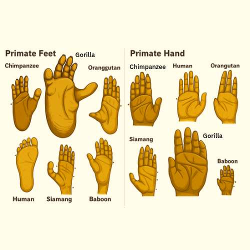
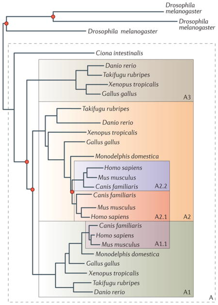

# Homología es binaria {.section-divider}

## La idea central

::: callout-box
**La homología para la biología evolutiva es binaria.** Dos secuencias
comparten un ancestro común o no lo comparten. No existe "45%
homólogas", igual que no existe "30% embarazada".
:::

- Lo que sí es continuo es la **similitud**: el porcentaje de residuos
  idénticos o parecidos
- La similitud puede **apoyar una inferencia** de homología
- Otras ramas de la ciencia y de la biología misma pueden tener su
  propia definición de homología.

## Los dos objetivos de hoy {.smaller}

1.  Qué es homología, y las diferentes **clases** de homología
2.  Y en todo caso, ¿qué importa si dos genes son parálogos, ohnólogos o
    *loqueseálogos*?

> *"El concepto de homología es un intento de identificar y nombrar las
> unidades de la organización fenotípica... El problema de identificar
> los bloques de construcción básicos de la realidad, sin embargo, no se
> limita a la biología comparativa, sino que es un objetivo de cada gran
> rama de la ciencia."*

[Günter P. Wagner, *Homology, Genes, and Evolutionary Innovation*,
Princeton 2014 (está en la biblioteca del Campus Juriquilla)]{.ref}

## El plan del día

| Horario | Bloque |
|----|----|
| 10:00–11:45 | Teoría: Owen, Fitch, árboles, inferencia de ortología, la conjetura |
| 11:45–12:15 | Descanso |
| 12:15–14:30 | Práctica: bases de datos y browsers, un genoma y siete paradas |
| 14:30–15:00 | Cierre, dudas |

# De dónde viene la palabra {.section-divider}

## Owen, 1843: antes de Darwin {.smaller}

- La homología es un concepto anterior a la biología molecular y
  anterior a Darwin: un concepto **morfológico** que data al menos de
  1843

> **Homólogo**: *"the same organ in different animals under **every
> variety of form and function**"*
>
> **Análogo**: *"a part or organ in one animal which has the same
> function as another part or organ in a different animal"*

- Owen fijó tres criterios para juzgar homología: **posición, desarrollo
  y composición**. Su marco era tipológico (idealista: un arquetipo, el
  *Bauplan*) y no tenía mecanismo evolutivo
- Darwin (1859) puso el mecanismo: la homología surge por **descendencia
  con modificación** desde un ancestro común. El arquetipo de los
  morfólogos fue reemplazado por el ancestro

::: notes
Los antecedentes son aún más viejos: ya Aristóteles, y Pierre Belon,
habían comparado esqueletos de ave y humano antes de 1555.
:::

## Homólogo, análogo, y un caso confuso {.smaller}

::: callout-box
**El ejemplo morfológico canónico.** El ala de murciélago, la aleta de
ballena y el brazo humano son homólogos: mismos huesos, mismas
posiciones relativas, distinta función. El ala de ave y el ala de
insecto son análogas: misma función, sin ancestro común alado.
:::

- De manera confusa, las aletas de los peces y las extremidades de los
  tetrápodos **también son homólogas**. No tienen los mismos huesos,
  pero claramente tienen un origen evolutivo común
- Son la "misma" estructura *bajo cada variedad de forma y función*

## Lo mismo, en otro animal y en otro lugar

{fig-align="center"
height="480"}

[Ilustración de Aakash Educational Services
([aakash.ac.in](https://www.aakash.ac.in)), sin licencia declarada; se
reproduce con fines docentes y con atribución]{.ref}

::: notes
Seis pies (izquierda) y seis manos (derecha): chimpancé, gorila,
orangután, humano, siamang, babuino. Cada pie de la izquierda tiene su
pareja a la derecha: el mismo animal, el mismo plan de extremidad, en el
otro extremo del cuerpo. La lámina ilustra la definición de Owen, y
además una distinción entre homologías que aplica a la definición de
Fitch de la sección siguiente. Hacer las dos lecturas por separado.
:::

## Dos lecturas de la misma lámina {.smaller}

::::: columns-equal
::: {}
**Panel de la derecha: extremidades anteriores**

- Mano de chimpancé contra mano de humano, o de orangután: *el mismo
  órgano en distintos animales*
- Mismos huesos (carpo, cinco metacarpianos, catorce falanges), en las
  mismas posiciones relativas, salidos del mismo primordio embrionario:
  los tres criterios de Owen.
- Variedad de forma y función: dedos larguísimos y pulgar corto para
  colgarse (orangután); palma ancha para caminar sobre los nudillos
  (gorila); pulgar largo y dedos cortos para agarre de precisión
  (humano)
- **Homología especial** (Owen 1848)
:::

::: {}
**Entre paneles**

- Mano de humano contra pie de humano: mismo animal, otro extremo del
  cuerpo
- Otra vez los mismos huesos (tarso por carpo, metatarsianos por
  metacarpianos, las mismas catorce falanges), cinco dedos, y el mismo
  programa de desarrollo activado dos veces.
- **Homología serial** (Owen 1848): *"la repetición o relación
  representativa entre los segmentos de un mismo esqueleto"*. El brazo
  es el *homotipo* de la pierna; la mano, del pie. Van Valen (1982) la
  llamó *homología repetitiva*, por oposición a la histórica
- La misma estructura, pero en otro lugar
:::
:::::

## La regla de dedo (*pun intended*) {.smaller}

| Comparación | Qué separó a las dos copias | Análogo molecular |
|----|----|----|
| Mano de chimpancé vs mano de humano | Una **especiación**, hace \~6–7 Ma. Hasta entonces eran literalmente una sola mano en un solo linaje | **Ortólogos** |
| Mano vs pie del mismo humano | Una **"duplicación"** del programa de extremidad, en un ancestro vertebrado con dos pares de apéndices. Desde entonces cada par evoluciona *en paralelo* (*para*) en todos los linajes | **Parálogos** |
| Pie de chimpancé vs mano de humano | Esa misma duplicación, y después la especiación | **Parálogos**, aunque estén en distintas especies |

## El papel de la similitud {.smaller}

- La mano humana se parece más a la mano del chimpancé que al pie
  humano: la copia separada por **especiación** conservó la función; la
  copia separada por **duplicación** hace otra cosa
- La **conjetura de los ortólogos**, en versión anatómica. Volvemos a
  ella después
- El pie de muchos primates tiene pulgar oponible y sigue manteniendo
  una función de agarre. Nuestro pie es la copia que más divergió: dejó
  de agarrar y se volvió una palanca para caminar en dos pies y correr

# Los genes tienen grados de "mismez" {.section-divider}

## De los alelos a los parálogos {.smaller}

- Una categoría de similitud por encima de ortólogos o parálogos son los
  **alelos**: variaciones de los genes que compiten para transmitirse a
  la siguiente generación
- Por consecuencia de esta herencia, los genes forman un **linaje
  evolutivo**. Cuando hay un evento de especiación, la historia del gen
  refleja la de las especies (α hemoglobina de humano y de ratón). A los
  *mismos* genes en diferentes especies se les denomina **ortólogos**,
  de *ortho* = exacto
- Fitch propuso que cuando la homología resulta de una **duplicación
  génica**, y las dos copias descienden lado a lado en la historia del
  organismo, los genes son **parálogos**, de *para* = en paralelo

> *"Phylogenies require orthologous, not paralogous, genes."*

[Fitch 1970, *Systematic Zoology* 19(2):99–113]{.ref}

## Dos copias, dos linajes {.smaller}

- Al duplicarse un gen hay dos copias del mismo gen en diferentes
  lugares del genoma (el criterio de **posición** de Owen)
- Ya son dos genes diferentes y cada uno comienza a formar su propio
  linaje e historia evolutiva. Pero, puesto que descienden del mismo
  ancestro, los parálogos **siguen siendo homólogos**

::: callout-box
**La identidad de un gen está basada en la continuidad hereditaria, no
en la similitud.** El "mismo" gen en diferentes especies puede ser muy
distinto en secuencia por todos los procesos evolutivos que ustedes
conocen.
:::

- La similitud es una **heurística** que sirve para identificar genes
  homólogos. Es parte de su definición *operativa* (la que usamos en la
  práctica), en contraste con la definición *conceptual* (su historia
  evolutiva, un linaje compartido), que rara vez podemos observar porque
  no podemos volver al pasado

## Por qué los ortólogos suelen ser los más parecidos {.smaller}

- Los parálogos ya no compiten entre sí para transmitirse a la siguiente
  generación: se rompe la necesidad de que un gen sólo transmita dos
  alelos. Un parálogo puede estar en **muchas copias**
- Por ello los ortólogos tienden a ser los genes más parecidos entre
  especies, aunque esta heurística **se rompe a menudo**
- Recuerden: el pie del chimpancé se parece más a la mano humana en
  forma y función que a su "paramorfo", el pie humano

::: callout-box
**Sobre el "% de homología".** En biología molecular a veces se usa en
referencia al grado de similitud esperado de dos genes que comparten un
linaje. De cierta manera refleja una visión residual o histórica. Otras
definiciones de homología aparecen en otros campos, como la sistemática.
:::

## Entonces ¿Por qué importa la distinción?

- Una manera de comparar contenido entre genomas (ver ej. BUSCO)
- Filogenias e inferencia de relaciones evolutivas entre especies.
- Más importante en esta era: anotación funcional de nuevos genomas

# La conjetura de los ortólogos {.section-divider}

## Qué afirma y por qué importa

- Los ortólogos conservan la función ancestral **más que los parálogos**
- Es el fundamento de todo el *transfer* de anotación funcional: cada
  vez que alguien anota un gen porque "se parece a este otro que sí está
  caracterizado", se está apoyando en esta *conjetura*.

## Evidencia para la conjetura {.smaller}

- **2011, el desafío**: Nehrt et al. compararon expresión y anotaciones
  GO en humano y ratón, y encontraron lo contrario de lo esperado: los
  parálogos con alta identidad eran más similares funcionalmente que los
  ortólogos
- **2012, las réplicas**: Altenhoff et al. rebatieron con un título que
  ya es la respuesta: *"Orthologs Tend to Be Weakly, but Significantly,
  More Similar in Function than Paralogs"*. Chen & Zhang y Thomas et
  al.: las anotaciones GO son un mal instrumento para probar esto
- **El confounder**: el sesgo de anotación en Gene Ontology domina el
  resultado (sesgo de autoría, términos desiguales por especie, rasgos
  que sólo se estudian en ciertas especies). Si las colas sólo se
  estudian en ratón, más genes de ratón se anotan con funciones "de
  cola"
- **2016–2020**: Kryuchkova-Mostacci & Robinson-Rechavi, con expresión
  en tejidos (menos sesgada que GO), apoyan la conjetura; Stamboulian et
  al. separan la lectura evolutiva de la predictiva, y concluyen que
  ortólogos y parálogos aportan información valiosa para predecir
  función

## Veredicto {.smaller}

::: callout-box
La conjetura sobrevive en **estadísticamente**. Los ortólogos tienden a
ser, en promedio, algo más conservados funcionalmente, pero el efecto es
pequeño, los parálogos también predicen función, y buena parte del
debate original fue un artefacto de las anotaciones. Es un debate
parcialmente resuelto, no un dogma.
:::

> *"Some researchers were 'baffled' that such an obvious assumption
> would be tested."*

Que una suposición parezca obvia es precisamente la razón para ponerla a
prueba.

[Stamboulian et al. 2020, *Bioinformatics* 36(Suppl_1):i219–i226]{.ref}

## Mitos y realidades: los ortólogos (1/2) {.smaller}

| Mito | Realidad |
|----|----|
| "Un gen tiene *un* ortólogo en la otra especie" | No implica uno a uno: las duplicaciones de linaje dan co-ortología uno-a-muchos y muchos-a-muchos. Lo que sí garantiza la definición: en un árbol correcto, los ortólogos forman un **clado que refleja la especiación** |
| "Evolucionan al mismo ritmo" | El reloj molecular no está en la definición; las tasas pueden ser arbitrariamente distintas |
| "Conservan secuencia, estructura o vecindario genómico" | Nada de eso está implícito |

[Adaptado de Gabaldón & Koonin 2013, *Nat Rev Genet* 14:360–366]{.ref}

## Mitos y realidades: los ortólogos (2/2) {.smaller}

| Mito | Realidad |
|----|----|
| "El ortólogo es la secuencia más parecida" | No necesariamente, ni sin duplicaciones. Y al revés: el mejor hit bidireccional puede no ser ortólogo (paralogía críptica tras pérdida diferencial; xenología) |
| "Ortólogo = misma función" | No lo implica; y genes con la misma función no son necesariamente ortólogos |
| "Entonces no sirve para predecir" | Sirve como **tendencia**: a escala de genoma, los ortólogos son en promedio los genes más parecidos en secuencia, estructura y función |

[Adaptado de Gabaldón & Koonin 2013, *Nat Rev Genet* 14:360–366]{.ref}

## Mitos y realidades: los parálogos {.smaller}

| Mito | Realidad |
|----|----|
| "Parálogos son genes duplicados *dentro* de una especie" | La paralogía se da también entre especies. Con pérdidas diferenciales y escenarios complejos, distinguir ortología de paralogía no es trivial |
| "Si son parálogos, ya hacen cosas distintas" | La paralogía no implica divergencia funcional: dos parálogos pueden hacer lo mismo y, por ejemplo, modular la dosis de una proteína |
| "Entonces da igual ortólogo o parálogo para predecir función" | Como tendencia general, los ortólogos son más similares en función que los parálogos, si bien, ambos aportan información. |

[Adaptado de Gabaldón & Koonin 2013, *Nat Rev Genet* 14:360–366]{.ref}

# Cómo se infiere ortología {.section-divider}

## Reciprocal Best Hits {.smaller}

- La heurística más utilizada A es ortólogo de B si A es el mejor hit de
  B **y** B es el mejor hit de A. Viene de los COGs (Tatusov, Koonin &
  Lipman 1997) y de Overbeek et al. (1999)
- El supuesto es que los ortólogos son las secuencias que **menos han
  divergido** entre dos especies, porque hasta la especiación eran el
  mismo gen. Como ya vimos, ese supuesto falla de diversas maneras.

::: desventaja
**"RBH es el estándar de oro para ortología."** Dalquen & Dessimoz
(2013) lo midieron: en clados ricos en duplicación (plantas y animales,
es decir, casi todo lo que nos interesa) hasta **\~60%** de las
relaciones ortólogas se pierden con el criterio BBH. RBH no maneja
relaciones muchos-a-muchos. Y Johnson (2007): RBH no es una condición
lógicamente suficiente para ortología. Ni necesaria.
:::

Úsenlo como heurística rápida, no como verdad.

## Cómo falla RBH {.smaller}

- **Duplicaciones específicas de linaje** los dos nuevos parálogos ahora
  son co-ortólogos al gen en la otra especie
- **Pérdida diferencial de genes** el ortólogo verdadero ya no está y
  gana otro
- **Tasas evolutivas dispares**: un parálogo que evolucionó más lento
  gana el best hit
- **Genes fusionados o arquitecturas de dominios**: el best hit cae
  sobre un dominio compartido
- **Errores de modelo génico** y genes de evolución rápida

::: notes
Ejemplo de casa: recuerden los dos receptores LGR de la babosa (chr6 y
chr10, los ohnólogos de la sesión 7) y como un árbol complejo de genes
similares en diferentes especies y con diversas calidades de anotación
complicaría calificar ortólogos 1:1.
:::

## La homología es transitiva

- La homología es **transitiva**: si el gen X es homólogo del gen Y, y Y
  es homólogo de Z en la misma región, entonces X y Z son homólogos,
  aunque BLAST no encuentre parecido directo entre ellos
- Es la propiedad que permite construir familias de proteínas
  encadenando parecidos débiles, y la que hace que los métodos de perfil
  funcionen
- No así la ortología y la paralogía! Ortología 1 a 1 en Ortogrupos
  "estrictos" sí. Ortogrupos jerárquicos no.

## Grafos, árboles y OrthoFinder {.smaller}

- **Basados en grafos**: OrthoMCL, InParanoid / InParanoiDB 9,
  SonicParanoid, Broccoli, Proteinortho, Hieranoid
- **Basados en árboles (reconciliación)**: comparan el árbol de genes
  con el de especies para identificar qué nodos son duplicación y cuáles
  especiación. TreeFam, Ensembl Compara, PhylomeDB, PANTHER. El
  fundamento es Page & Charleston (1997)
- **OrthoFinder** (Emms & Kelly 2015, 2019) es hoy el método de
  referencia: el más preciso en el benchmark Quest for Orthologs.
  Produce orthogroups, árboles de genes enraizados, eventos de
  duplicación y un árbol de especies enraizado, a velocidad comparable a
  las heurísticas
- **REvolutionH-tl** es basado en grafos pero reconcilia también con el
  árbol de especies. "it matches or exceeds the performance of widely
  used tools, while being significantly faster" José Antonio Ramírez con
  colegas de Maribel Hernández-Rosales (2026) en Cinvestav Irapuato.
- **Sintenia** (desempate tras WGD)

## Ortogrupo se define respecto a un ancestro {.smaller}

::::: columns-equal
::: {}
{height="470"}
:::

::: {}
- **Ortogrupo**: los genes, de varias especies, que descienden de **un
  solo gen** en el último ancestro común de esas especies. ¿*cuál*
  ancestro?
- Puntos rojos: duplicaciones. Dos en la base de los vertebrados, una en
  el ancestro de los mamíferos
- Respecto al ancestro de los **cordados** (la caja punteada, con
  *Ciona*): un solo grupo
- Respecto al de los **vertebrados**: tres, A1, A2 y A3
- Respecto al de los **mamíferos**: A2 se parte en A2.1 y A2.2,
  parálogos entre sí y co-ortólogos de los A2 de pez, rana y pollo. A1.1
  es A1 visto desde ahí, sin duplicación
- Por eso son **jerárquicos** (Hierarchical Orthologous Groups): uno por
  nivel, anidados.
:::
:::::

[Gabaldón & Koonin 2013, *Nat Rev Genet* 14:360–366, fig. 2 (© Springer
Nature); se reproduce con fines docentes y con atribución]{.ref}

## Bases de datos y qué método uso {.smaller}

- **OrthoDB** (catálogo jerárquico; la base de BUSCO) · **eggNOG**
  (pre-clustering por dominios más detección filogenética) · **OMA**
  ([omabrowser.org](https://omabrowser.org)) · Ensembl Compara ·
  InParanoiDB 9 · PANTHER

::: desventaja
**HomoloGene (NCBI) está descontinuada.** Se retiró en enero de 2024; su
última compilación es de 2014. El reemplazo es **NCBI Orthologs**, vía
NCBI Datasets y la base Gene.
:::

| Necesitas                                | Opciones                        |
|------------------------------------------|---------------------------------|
| Alta **sensibilidad**                    | Ensembl Compara, OMA HOGs       |
| Alta **especificidad**, relaciones 1-a-1 | RSD, InParanoid                 |
| Análisis propio de novo                  | **OrthoFinder, REvolutionH-tl** |
| Especies modelo                          | Alliance of Genome Resources    |

::: notes
El consorcio Quest for Orthologs (Altenhoff et al. 2016) mantiene el
benchmark y un servicio web público, y deliberadamente no corona un
único mejor método, porque la elección depende de para qué.
:::

## Cómo se delata una transferencia horizontal {.smaller}

Un gen que llegó de otro linaje suele traer tres marcas:

- **Composición atípica**: contenido de GC y uso de codones que no
  cuadran con el resto del genoma huésped (sesiones 2 y 3)
- **Distribución filogenética irregular**: el mismo gen aparece en
  géneros no emparentados y falta en parientes cercanos. Es exactamente
  la incongruencia entre árbol de genes y árbol de especies
- **Contexto genómico**: elementos móviles flanqueando el gen:
  secuencias de inserción, transposones, integrones

Ninguna de las tres prueba nada por sí sola. Las tres juntas son un caso
sólido.

## El resumen

1.  **Lo que diferencia entre ortólogos y parálogos es el evento de
    especiación (ortólogos) o duplicación (parálogos)**
2.  **Reciprocal Best Hits pierde hasta 60% de los ortólogos en
    eucariotas con duplicación.** Ni conceptual ni empíricamente es
    suficiente para definir ortología.
3.  La definición es importante hasta donde es útil. Otras ramas de la
    ciencia y de la biología tienen su propia definición.

## El vocabulario completo {.smaller}

| Término | Relación | Origen |
|----|----|----|
| **Ortólogo** | Separados por **especiación** | Fitch 1970 |
| **Parálogo** | Separados por **duplicación** | Fitch 1970 |
| **Xenólogo** | Separados por **transferencia horizontal** | Gray & Fitch 1983 |
| **Ohnólogo** | Parálogo por **duplicación de genoma completo** | por Susumu Ohno (1970) |
| **In-paralog** | Duplicado **después** de la especiación considerada | Remm et al. 2001 |
| **Out-paralog** | Duplicado **antes** de la especiación considerada | Sonnhammer & Koonin 2002 |

- Los in-paralogs son **co-ortólogos** en conjunto respecto al gen de la
  otra especie: si un gen se duplicó después de que los linajes se
  separaron, ambas copias son ortólogas del gen de la otra especie,
  colectivamente. Los out-paralogs nunca lo son
- Distinguirlos es lo que permite manejar las relaciones uno-a-muchos y
  muchos-a-muchos, que son la **norma** y no la excepción

::: notes
Los ohnólogos ya los vieron en la práctica de la sesión 7: los dos
receptores LGR de la babosa en los cromosomas 6 y 10.
:::

# La práctica de hoy. Después del break {.section-divider}

## Bases de datos y browsers {.smaller}

- La práctica de esta sesión no es de homología: es la de la **unidad 4,
  bases de datos y browsers**, con sus propias
  [diapositivas](sesion10-bases-datos-browsers.html) y su [página con
  soluciones](../contenido/04-bases-datos-browsers/sesion10-practica.html)

::: notes
Pendientes de instructor: correr practicas/datos/descargar-babosa.sh,
copiar la carpeta babosa/ a /datos/cursos/bioinfo1/sesion10/ y a la USB,
y verificar-herramientas-sesion10.sh en ken.
:::

::: callout-box
Capítulo de referencia: [Homología: ortólogo, parálogo,
xenólogo](../contenido/03-alineamientos/homologia.html)
:::

## Lectura {.smaller}

- Fitch 1970, *Syst Zool*: el párrafo original

- Wagner 2014, *Homology, Genes, and Evolutionary Innovation*,
  Princeton: en la biblioteca del Campus Juriquilla

- Koonin 2005, *Annu Rev Genet*: *Orthologs, paralogs, and evolutionary
  genomics*

- Dalquen & Dessimoz 2013, *Genome Biol Evol*: por qué RBH pierde
  ortólogos

- Altenhoff, Glover & Dessimoz 2019, *Methods Mol Biol* 1910: *Inferring
  orthology and paralogy*, el manual de los métodos

- Fernández, Gabaldón & Dessimoz 2020, en *Phylogenetics in the Genomic
  Era* (libro de acceso abierto): *Orthology: definitions, inference,
  and impact on species phylogeny inference*

- Majidian et al. y el consorcio Quest for Orthologs 2025, *J Mol Evol*
  93:702: *Quest for Orthologs in the era of Data Deluge and AI*

- Heladia Salgado: [Homología y
  ciclos](https://lcg-cursos.github.io/material/introbioinfo/blast_var_for_scripts.html#34)
